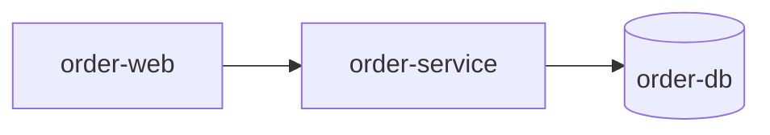

# Containers (C4 mức 2)

## Danh sách container
<!-- required -->

| Container | Loại | Vai trò | Công nghệ | Đơn vị triển khai | Scale, nâng cấp, bảo trì |
| --- | --- | --- | --- | --- | --- |
| order-service | service | API đặt đơn | [Node.js](../02-tech-stack/layers/backend.md) | service riêng | [scaling.md](../06-backend/services/order-service/scaling.md) |
| order-web | app | Ứng dụng web cho khách và nhân viên | [React](../02-tech-stack/layers/frontend.md) | file tĩnh do order-service phục vụ | [build-delivery.md](../05-frontend/order-web/build-delivery.md) |
| order-db | database | Lưu đơn | [PostgreSQL](../02-tech-stack/layers/data.md) | service riêng | [layers/data.md](../02-tech-stack/layers/data.md) |

## Sơ đồ
<!-- required -->

## Liên lạc giữa container
<!-- required -->

| Từ | Đến | Kiểu | Lý do | Luồng |
| --- | --- | --- | --- | --- |
| order-web | order-service | đồng bộ | gọi API đặt đơn, xem và đổi trạng thái | FL-001, FL-002, FL-003 |
| order-service | order-db | đồng bộ | đọc và ghi đơn | FL-001, FL-002, FL-003 |

## Rủi ro
<!-- required -->

Order-service và order-db dùng chung máy ảo đã khai trong [sổ rủi ro](../11-risks/risk-register.md): R-003.
