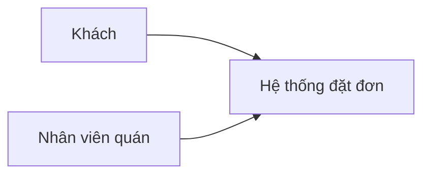

# Bối cảnh hệ thống (C4 mức 1)

## Hệ thống và người dùng
<!-- required -->

Hệ thống nhận đơn mang đi của quán cafe và cho khách theo dõi trạng thái đơn.

| Tác nhân | Vai trò | Tương tác với hệ thống | Yêu cầu (FR) |
| --- | --- | --- | --- |
| Khách | đặt món mang đi | đặt đơn, xem trạng thái đơn qua API | FR-001, FR-002 |
| Nhân viên quán | pha chế và giao món | cập nhật trạng thái đơn qua API | FR-003 |

## Phạm vi
<!-- required -->

- Trong phạm vi: nhận đơn, lưu đơn, cập nhật và tra cứu trạng thái đơn (FR-001, FR-002, FR-003).
- Ngoài phạm vi: thanh toán (không lưu dữ liệu thanh toán, theo [project-profile.md](../00-context/project-profile.md)) và giao diện của khách và nhân viên.

## Hệ thống ngoài
<!-- required -->

Không có hệ thống ngoài; xem [integrations.md](integrations.md).

## Sơ đồ
<!-- required -->

## Rủi ro
<!-- required -->

Không có rủi ro mới ở ranh giới hệ thống.
