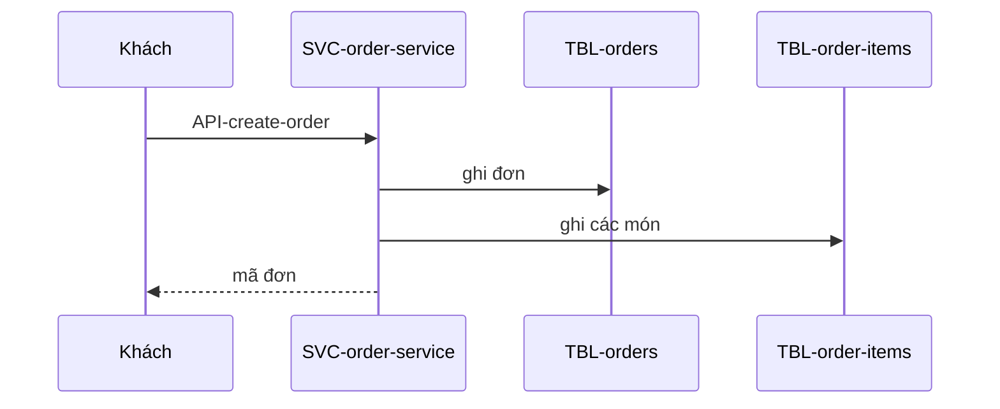

# FL-001: Đặt đơn

## Yêu cầu liên quan
<!-- required -->

- FR: FR-001
- NFR: NFR-001
- Ràng buộc: C-001

## Tác nhân và điều kiện
<!-- required -->

- Tác nhân: khách
- Kích hoạt: khách bấm đặt đơn
- Điều kiện trước: giỏ có ít nhất một món
- Kết quả: đơn ở trạng thái mới

## Sơ đồ tuần tự
<!-- required -->

## Lỗi và xử lý
<!-- required -->

| Bước | Lỗi | Hậu quả cho người dùng | Xử lý (thử lại, thời gian chờ, bù trừ) | Cơ sở |
| --- | --- | --- | --- | --- |
| 2 | ghi database lỗi | khách thấy lỗi và đặt lại | thử lại 2 lần, mỗi lần chờ 1 giây, rồi trả lỗi | NFR-001 |

## Dữ liệu chạm tới
<!-- required -->

| Loại | ID | Thao tác | Bước |
| --- | --- | --- | --- |
| bảng | TBL-orders | ghi | 2 |
| bảng | TBL-order-items | ghi | 3 |

## Tối ưu
<!-- required -->

| Chỉ số | Mục tiêu (số + đơn vị) | NFR | Cách đo |
| --- | --- | --- | --- |
| p95 toàn luồng | dưới 300 ms | NFR-001 | log truy cập của order-service |

## Rủi ro
<!-- required -->

Không có rủi ro mới: luồng chỉ dùng một service và một database đã chốt ở D-001.
