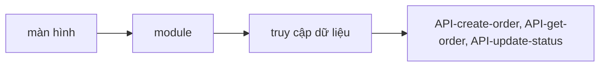

# Kiến trúc của app order-web

## Lớp
<!-- required -->

| Lớp | Trách nhiệm | Được phụ thuộc vào | Không được phụ thuộc vào |
| --- | --- | --- | --- |
| trình bày | nối route với module, giữ state cục bộ của màn hình | ứng dụng | truy cập dữ liệu |
| ứng dụng | điều phối một việc của người dùng (đặt đơn, xem đơn, đổi trạng thái) | truy cập dữ liệu | trình bày |
| truy cập dữ liệu | gọi API, cache, thử lại, ánh xạ lỗi | không có | trình bày, ứng dụng |

## Module
<!-- required -->

| Module | Trách nhiệm | Màn hình (SCR) | Dữ liệu sở hữu | Yêu cầu (FR) |
| --- | --- | --- | --- | --- |
| ordering | giữ giỏ và gửi đơn | SCR-order-form | giỏ (state cục bộ) | FR-001 |
| tracking | lấy và làm mới trạng thái đơn | SCR-order-status | đơn (cache truy vấn theo mã đơn) | FR-002 |
| staff | mở đơn và đổi trạng thái | SCR-staff-update | đơn (cache truy vấn theo mã đơn) | FR-003 |
| session | giữ khóa nhân viên trong bộ nhớ và gắn vào request | SCR-staff-update | khóa nhân viên (state dùng chung) | FR-003 |

## Luồng dữ liệu
<!-- required -->

## Đo thực tế và báo lỗi
<!-- required -->

Không dùng dịch vụ đo hay báo lỗi bên thứ ba: dự án không có hệ thống ngoài (xem [integrations.md](../../01-system/integrations.md)). Số liệu mục tiêu ở [performance-budget.md](../performance-budget.md).

| Việc | Công cụ | Dữ liệu thu | Tần suất lấy mẫu (phần trăm) | Cơ sở |
| --- | --- | --- | --- | --- |
| đo tải trang và lỗi tải file tĩnh | log truy cập của order-service | kích thước tải, mã lỗi HTTP, chuỗi trình duyệt; không có dữ liệu cá nhân | 100% | NFR-001 |

## Rủi ro
<!-- required -->

Rủi ro hiệu năng trên thiết bị yếu đã khai trong [sổ rủi ro](../../11-risks/risk-register.md): R-001.
