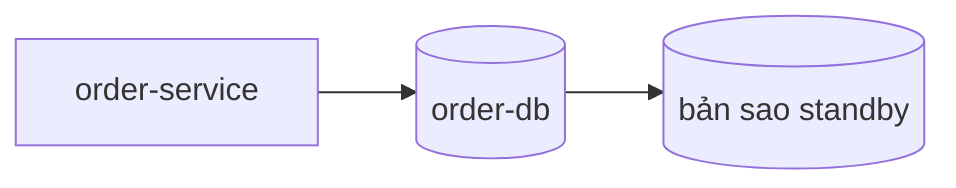

# Dữ liệu: tổng quan

## Bản đồ kho dữ liệu
<!-- required -->

| Kho | Loại | Công nghệ | Service sở hữu | Chi tiết |
| --- | --- | --- | --- | --- |
| order-db | database | [PostgreSQL](../02-tech-stack/layers/data.md) | SVC-order-service | [tables.md](databases/order-db/tables.md) |

Không có object storage, cache hay kênh messaging; lý do ở [project-profile.md](../00-context/project-profile.md).

## Nguồn sự thật
<!-- required -->

| Dữ liệu | Nguồn sự thật | Bản sao hoặc cache | Cách giữ đồng bộ |
| --- | --- | --- | --- |
| đơn và các món của đơn | order-db | bản sao standby của PostgreSQL | [consistency.md](consistency.md) |

## Luồng dữ liệu giữa các kho
<!-- required -->

## Tối ưu
<!-- required -->

| Chỉ số | Mục tiêu (số + đơn vị) | NFR | Cách đo |
| --- | --- | --- | --- |
| p95 thời gian truy vấn của luồng đặt đơn | 50 ms | NFR-001 | log truy vấn của order-db |

## Scale, nâng cấp, bảo trì
<!-- required -->

| Kho | Nơi đã viết |
| --- | --- |
| order-db | [partitioning-retention.md](databases/order-db/partitioning-retention.md), [migration-strategy.md](databases/order-db/migration-strategy.md) |

## Rủi ro
<!-- required -->

Rủi ro khôi phục dữ liệu đã khai trong [sổ rủi ro](../11-risks/risk-register.md): R-002.
