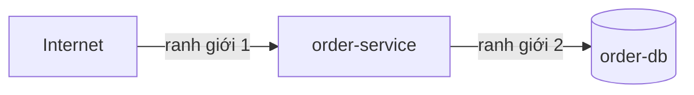

# Mô hình mối đe dọa

## Tài sản cần bảo vệ
<!-- required -->

| Tài sản | Vì sao quan trọng | Nơi lưu | Yêu cầu (FR hoặc C) |
| --- | --- | --- | --- |
| đơn và trạng thái đơn | sửa trái phép làm sai việc pha chế và giao món | order-db | FR-002, FR-003 |
| khóa nhân viên | lộ khóa cho người ngoài đổi được trạng thái mọi đơn | bản băm trong cấu hình bí mật | FR-003 |
| khóa HMAC ký mã tra cứu | lộ khóa cho phép làm giả mã tra cứu của mọi đơn | tệp cấu hình bí mật | FR-002 |

## Ranh giới tin cậy
<!-- required -->

| Ranh giới | Hai phía | Cơ chế kiểm soát |
| --- | --- | --- |
| ranh giới 1 | Internet và order-service | TLS, giới hạn tần suất, mã tra cứu có chữ ký, khóa nhân viên |
| ranh giới 2 | order-service và order-db | mạng riêng giữa hai bên, tài khoản database quyền tối thiểu |

## Mối đe dọa
<!-- required -->

| Mối đe dọa | Loại | Tài sản | Biện pháp | Rủi ro (R) | Biện pháp nằm ở |
| --- | --- | --- | --- | --- | --- |
| dò mã tra cứu: kẻ tấn công thử nhiều mã đơn để xem đơn của người khác | lộ thông tin | đơn và trạng thái đơn | mã gồm id kèm chữ ký HMAC 128 bit nên không đoán được; mã sai trả lỗi không tìm thấy; giới hạn 5 request/giây mỗi IP; cảnh báo khi một IP gặp nhiều lỗi không tìm thấy | R-004 | [cross-cutting.md](../06-backend/cross-cutting.md), [observability.md](../09-infrastructure/observability.md) |
| lộ hoặc đoán khóa nhân viên | giả mạo | khóa nhân viên | khóa ngẫu nhiên 256 bit, chỉ lưu bản băm, xoay 90 ngày, gỡ ngay khi nhân viên nghỉ | R-005 | [secrets-compliance.md](secrets-compliance.md) |
| lộ khóa HMAC làm giả mã tra cứu | giả mạo | khóa HMAC ký mã tra cứu | quyền tệp tối thiểu, xoay 365 ngày với cửa sổ hai khóa | R-005 | [secrets-compliance.md](secrets-compliance.md) |
| gửi đơn rác hàng loạt làm đầy database | từ chối dịch vụ | order-db | giới hạn tần suất theo IP, giới hạn kích thước request | R-004 | [cross-cutting.md](../06-backend/cross-cutting.md) |

## Rủi ro còn lại
<!-- required -->

- dò mã tra cứu chia nhỏ qua các IP khác nhau, mỗi IP dưới 5 request/giây (NFR-003), vẫn vượt giới hạn theo IP: R-004

## Bảo trì
<!-- required -->

| Việc định kỳ | Tần suất | Giờ mỗi tháng | Cơ sở ước tính |
| --- | --- | --- | --- |
| rà lại mô hình khi đổi kiến trúc hoặc thêm hệ thống ngoài | mỗi quý | 1 giờ | C-002 |
