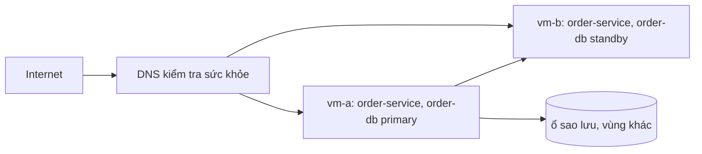

# Hạ tầng: topology

## Thành phần hạ tầng
<!-- required -->

| Thành phần | Loại | Công nghệ hoặc nhà cung cấp | Vùng | Chứa container | Cỡ và số lượng |
| --- | --- | --- | --- | --- | --- |
| vm-a | máy ảo | [Ubuntu Server](../02-tech-stack/layers/infrastructure.md) | vùng chính, khu A | order-service, order-web (file tĩnh), order-db primary | [compute-sizing.md](../03-capacity/compute-sizing.md) |
| vm-b | máy ảo | [Ubuntu Server](../02-tech-stack/layers/infrastructure.md) | vùng chính, khu B | order-service, order-web (file tĩnh), order-db standby | [compute-sizing.md](../03-capacity/compute-sizing.md) |
| ổ sao lưu | ổ đĩa riêng | nhà cung cấp hạ tầng | vùng khác với vùng chính | bản sao lưu của order-db | [cost-model.md](../03-capacity/cost-model.md) |

## Chia tài nguyên máy ảo

Mỗi máy ảo (cỡ ở [compute-sizing.md](../03-capacity/compute-sizing.md), 4 GB RAM) chạy order-service và PostgreSQL. CPU: năng lực mỗi instance ở [compute-sizing.md](../03-capacity/compute-sizing.md) đã đo khi hai bên chạy cùng máy, nên số instance đã gồm tải của PostgreSQL. RAM chia như sau:

| Phần | RAM (GB) | Cơ sở |
| --- | --- | --- |
| hệ điều hành | 0,5 | [Ubuntu Server](https://ubuntu.com/server/docs/system-requirements) |
| order-service (Node.js) | 0,5 | D-004 |
| PostgreSQL shared_buffers | 1 | [tài liệu PostgreSQL](https://www.postgresql.org/docs/16/runtime-config-resource.html) |
| PostgreSQL bộ nhớ làm việc và kết nối | 0,5 | [tài liệu PostgreSQL](https://www.postgresql.org/docs/16/runtime-config-resource.html) |
| bộ nhớ đệm trang của hệ điều hành cho dữ liệu | 1,5 | dung lượng dữ liệu ở [data-sizing.md](../03-capacity/data-sizing.md) |

## Mạng
<!-- required -->

| Mục | Giá trị | Cơ sở |
| --- | --- | --- |
| Phân tách mạng | mạng công khai chỉ mở cổng 443 của order-service; mạng riêng giữa vm-a và vm-b cho nhân bản PostgreSQL | |
| Điểm vào từ Internet | tên miền con của tên miền quán đã có, DNS kiểm tra sức khỏe trỏ tới vm-a và vm-b; không có load balancer riêng | C-001 |
| Luồng ra Internet | chỉ tải gói hệ điều hành và ảnh build; không gọi hệ thống ngoài | |
| Tên miền và chứng chỉ | DNS do quán quản lý; chứng chỉ gia hạn tự động mỗi 60 ngày | [Mozilla TLS](https://wiki.mozilla.org/Security/Server_Side_TLS) |
| Giới hạn băng thông ra (GB mỗi tháng) | xem [cost-model.md](../03-capacity/cost-model.md) | |

## Sơ đồ
<!-- required -->

## Tối ưu
<!-- required -->

| Chỉ số | Mục tiêu (số + đơn vị) | NFR | Cách đo |
| --- | --- | --- | --- |
| mức dùng CPU trung bình của máy ảo ở tải đỉnh | 70% | NFR-001 | giám sát máy ảo |
| chi phí hạ tầng so với ngân sách | 50% | C-001 | so [cost-model.md](../03-capacity/cost-model.md) với ngân sách |

## Nâng cấp
<!-- required -->

| Thành phần | Phiên bản chốt | Ngày hết hỗ trợ gần nhất | Đường nâng cấp | Gián đoạn tối đa (giây) | Cơ sở |
| --- | --- | --- | --- | --- | --- |
| hệ điều hành của vm-a và vm-b | Ubuntu Server 24.04, xem [versions-features.md](../02-tech-stack/versions-features.md) | 2029-05-31, [ghi chú phát hành 24.04](https://documentation.ubuntu.com/release-notes/24.04/) | dựng máy ảo mới bằng bản LTS kế tiếp, chuyển từng máy một | 0 | NFR-002 |

## Bảo trì
<!-- required -->

| Việc định kỳ | Tần suất | Giờ mỗi tháng | Cơ sở ước tính |
| --- | --- | --- | --- |
| vá hệ điều hành, gia hạn chứng chỉ, dọn tài nguyên thừa | mỗi tháng | 2 giờ | C-002 |

## Rủi ro
<!-- required -->

Rủi ro order-service và PostgreSQL dùng chung máy ảo đã khai trong [sổ rủi ro](../11-risks/risk-register.md): R-003.
