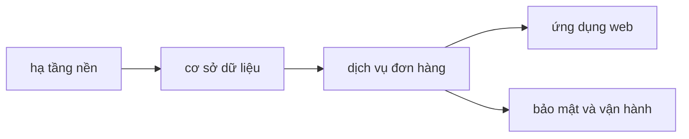

# Kế hoạch triển khai

## Nguyên tắc cho agent dev
<!-- required -->

- Tài liệu trong gói là nguồn sự thật; không thêm thành phần, API, bảng hay phiên bản ngoài tài liệu.
- Chỗ tài liệu mâu thuẫn hoặc thiếu: dừng và hỏi (ghi câu hỏi), không tự quyết.
- Phiên bản công nghệ đúng như [versions-features.md](../02-tech-stack/versions-features.md); muốn đổi thì đi qua chế độ nâng cấp.
- Phần giao diện nhìn thấy do designer quyết; agent dev chỉ làm theo tài liệu của designer (`SCR-xx`).

### Áp dụng cho dự án
<!-- required -->

- Câu hỏi của agent dev: ghi vào `questions.md` của workspace với mã bắt đầu bằng CH; nhân viên vận hành trả lời trong vòng 2 ngày làm việc (C-003).
- Đổi phiên bản công nghệ: thành viên backend đề xuất, nhân viên vận hành duyệt, rồi cập nhật [versions-features.md](../02-tech-stack/versions-features.md) và `CHANGELOG.md` của lần phát hành kế tiếp.
- Tài liệu của designer: `inputs/ui-design/screens.md` (3 màn hình `SCR-xx`); agent dev của ứng dụng web chỉ lấy `SCR-xx` từ đó.
- Mỗi gói là một nhánh tính năng ngắn trong một repo (xem [repo-structure.md](../06-backend/repo-structure.md)), merge theo [delivery.md](../10-process/delivery.md).

## Gói công việc
<!-- required -->

| Gói | Phạm vi | Tài liệu đầu vào | Yêu cầu (FR) và luồng (FL) | Phụ thuộc gói | Công sức ước tính (giờ) | Cơ sở ước tính |
| --- | --- | --- | --- | --- | --- | --- |
| hạ tầng nền | hai máy ảo, môi trường, CI/CD | [topology.md](../09-infrastructure/topology.md), [environments.md](../09-infrastructure/environments.md), [ci-cd.md](../09-infrastructure/ci-cd.md) | FR-001, FR-002, FR-003 | không | 24 | C-003 |
| cơ sở dữ liệu | TBL-orders, TBL-order-items | [tables.md](../07-data/databases/order-db/tables.md), [indexing.md](../07-data/databases/order-db/indexing.md), [migration-strategy.md](../07-data/databases/order-db/migration-strategy.md) | FR-001, FR-002, FR-003; FL-001, FL-002, FL-003 | hạ tầng nền | 16 | C-003 |
| dịch vụ đơn hàng | SVC-order-service | [responsibility.md](../06-backend/services/order-service/responsibility.md), [api.md](../06-backend/services/order-service/api.md), [cross-cutting.md](../06-backend/cross-cutting.md) | FR-001, FR-002, FR-003; FL-001, FL-002, FL-003 | cơ sở dữ liệu | 60 | C-003 |
| ứng dụng web | order-web | [architecture.md](../05-frontend/order-web/architecture.md), [routing-navigation.md](../05-frontend/order-web/routing-navigation.md), [state-data.md](../05-frontend/order-web/state-data.md) | FR-001, FR-002, FR-003 | dịch vụ đơn hàng | 48 | C-003 |
| bảo mật và vận hành | khóa, giám sát, runbook, sao lưu | [secrets-compliance.md](../08-security/secrets-compliance.md), [observability.md](../09-infrastructure/observability.md), [operations.md](../10-process/operations.md) | FR-003 | dịch vụ đơn hàng | 16 | C-003 |

## Thứ tự và phụ thuộc
<!-- required -->

Ứng dụng web và gói bảo mật làm song song được sau khi dịch vụ đơn hàng có API; hạ tầng nền phải xong trước vì mọi gói cần môi trường và CI.

## Tiêu chí hoàn thành
<!-- required -->

| Gói | Tiêu chí đạt (kiểm được) | NFR | Cách kiểm |
| --- | --- | --- | --- |
| hạ tầng nền | pipeline chạy đủ các giai đoạn và rollback trong 10 phút | NFR-002 | chạy thử pipeline ở staging |
| cơ sở dữ liệu | migration đầu tiên chạy xong, khóa bảng không quá 2 giây | NFR-002 | nhật ký migration |
| dịch vụ đơn hàng | p95 độ trễ đặt đơn dưới 300 ms ở tải đỉnh | NFR-001 | kiểm thử tải |
| ứng dụng web | JS tải ban đầu tối đa 170 KB nén và LCP tối đa 2,5 s | NFR-001 | bước đo hiệu năng trong CI |
| bảo mật và vận hành | khôi phục thử xong trong 240 phút | NFR-002 | diễn tập khôi phục |

## Truy vết yêu cầu sang gói
<!-- required -->

- FR-001: dịch vụ đơn hàng, cơ sở dữ liệu, ứng dụng web
- FR-002: dịch vụ đơn hàng, cơ sở dữ liệu, ứng dụng web
- FR-003: dịch vụ đơn hàng, cơ sở dữ liệu, ứng dụng web, bảo mật và vận hành
