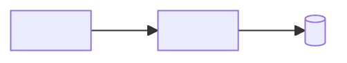

# Containers (C4 mức 2)

> Template của design-architecture. Mục có `<!-- required -->` là bắt buộc. File này chỉ nhắc ID (`SVC-xx`…), không định nghĩa: cột đầu là tên container, không phải ID. Mỗi container có đường scale, nâng cấp, bảo trì (Q3) bằng cách dẫn link tới nơi đã viết, không chép lại: service ở `scaling.md`, các lớp còn lại ở mục "Scale, nâng cấp, bảo trì" của `layers/{layer}.md`. Mỗi tham số thiết kế (số có đơn vị: thời gian chờ, giới hạn, ngưỡng, giờ bảo trì…) có ô "Cơ sở" hoặc "Cơ sở ước tính": ô đó chỉ tính là bằng chứng khi có ID (NFR, C, A, D, R, TC) hoặc link; chữ thuần ("kinh nghiệm team") thì `check_numbers.py` vẫn báo lỗi.

## Danh sách container
<!-- required -->

Mọi service, database, ứng dụng frontend, hàng đợi, cache và kho object của dự án có đúng một dòng.

| Container | Loại | Vai trò | Công nghệ | Đơn vị triển khai | Scale, nâng cấp, bảo trì |
| --- | --- | --- | --- | --- | --- |
| <tên> | <service, database, app, queue, cache, object storage> | <một câu, SVC-xx nếu là service> | <[tên](../02-tech-stack/layers/{layer}.md)> | <service riêng, module trong monolith, managed> | <[liên kết](đường-dẫn.md)> |

## Sơ đồ
<!-- required -->

## Liên lạc giữa container
<!-- required -->

Cách gọi, thời gian chờ, thử lại nằm ở [communication.md](../06-backend/communication.md); ở đây chỉ nêu ai nói chuyện với ai.

| Từ | Đến | Kiểu | Lý do | Luồng |
| --- | --- | --- | --- | --- |
| <container> | <container> | <đồng bộ, bất đồng bộ> | <vì sao có liên lạc này> | <FL-xx> |

## Rủi ro
<!-- required -->

Rủi ro của cách chia container (điểm hỏng đơn, ghép chặt) đã khai trong [sổ rủi ro](../11-risks/risk-register.md): <R-xx, …>, hoặc ghi "không có".
