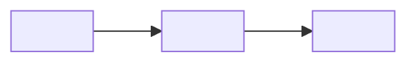

# Bối cảnh hệ thống (C4 mức 1)

> Template của design-architecture. Mục có `<!-- required -->` là bắt buộc. File này chỉ nhắc ID, không định nghĩa ID nào: không đặt `FR-`, `SVC-`… ở ô đầu dòng bảng. Mức S bỏ file này. Mỗi tham số thiết kế (số có đơn vị: thời gian chờ, giới hạn, ngưỡng, giờ bảo trì…) có ô "Cơ sở" hoặc "Cơ sở ước tính": ô đó chỉ tính là bằng chứng khi có ID (NFR, C, A, D, R, TC) hoặc link; chữ thuần ("kinh nghiệm team") thì `check_numbers.py` vẫn báo lỗi.

## Hệ thống và người dùng
<!-- required -->

<một câu: hệ thống làm gì cho ai>

| Tác nhân | Vai trò | Tương tác với hệ thống | Yêu cầu (FR) |
| --- | --- | --- | --- |
| <người dùng hoặc hệ thống ngoài> | <vai trò> | <làm gì, qua kênh nào> | <FR-xx> |

## Phạm vi
<!-- required -->

- Trong phạm vi: <việc hệ thống làm, truy về FR-xx>
- Ngoài phạm vi: <việc không làm, và ai làm thay>

## Hệ thống ngoài
<!-- required -->

Chi tiết cách gọi, lỗi và fallback nằm ở [integrations.md](integrations.md); ở đây chỉ nêu ranh giới. Không có hệ thống ngoài thì ghi "không có".

| Hệ thống ngoài | Chiều dữ liệu | Dữ liệu trao đổi |
| --- | --- | --- |
| <tên> | <vào, ra, hai chiều> | <loại dữ liệu> |

## Sơ đồ
<!-- required -->

## Rủi ro
<!-- required -->

Rủi ro ở ranh giới hệ thống (phụ thuộc bên ngoài, phạm vi mơ hồ) đã khai trong [sổ rủi ro](../11-risks/risk-register.md): <R-xx, …>, hoặc ghi "không có".
