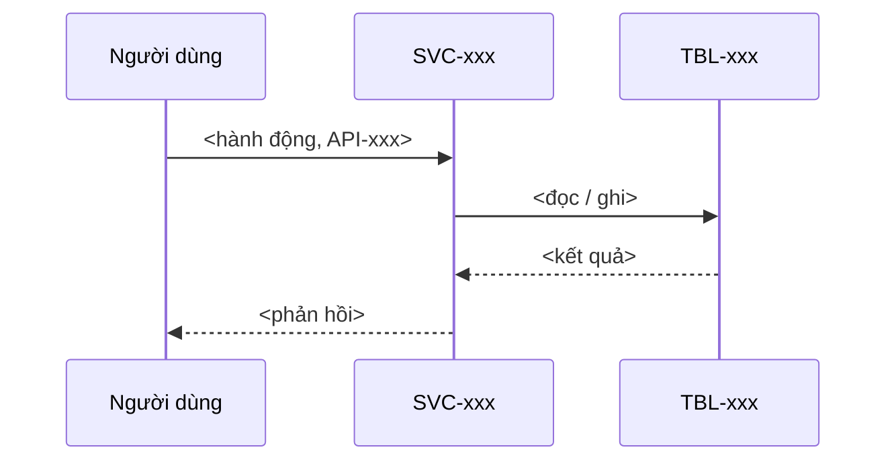

# FL-xxx: <tên luồng>

> Template của design-architecture, một file mỗi luồng. `FL-xx` được định nghĩa ở heading trên (không định nghĩa ở nơi khác). Mục có `<!-- required -->` là bắt buộc. Nhắc FR bằng ID (`FR-xx`) trong mục "Yêu cầu liên quan"; nhắc bảng, bucket, event, service, API bằng ID (`TBL-`, `BKT-`, `EVT-`, `SVC-`, `API-`) trong sơ đồ và bảng "Dữ liệu chạm tới"; những ID này được định nghĩa ở G7 (`06-backend/`, `07-data/`) nên G6 có thể chưa có. Không đặt FR/TBL/… ở ô đầu dòng bảng (chỉ nơi định nghĩa mới làm vậy). Mỗi tham số thiết kế (số có đơn vị: thời gian chờ, giới hạn, ngưỡng, giờ bảo trì…) có ô "Cơ sở" hoặc "Cơ sở ước tính": ô đó chỉ tính là bằng chứng khi có ID (NFR, C, A, D, R, TC) hoặc link; chữ thuần ("kinh nghiệm team") thì `check_numbers.py` vẫn báo lỗi.

## Yêu cầu liên quan
<!-- required -->

- FR: <FR-xx, …>
- NFR: <NFR-xx>
- Ràng buộc: <C-xx, hoặc "không có">

## Tác nhân và điều kiện
<!-- required -->

- Tác nhân: <ai bắt đầu luồng>
- Kích hoạt: <sự kiện hoặc hành động>
- Điều kiện trước: <trạng thái hệ thống cần có>
- Kết quả: <trạng thái sau khi luồng thành công>

## Sơ đồ tuần tự
<!-- required -->

## Lỗi và xử lý
<!-- required -->

Mỗi bước có thể hỏng có một dòng; số lần thử lại và thời gian chờ là số có đơn vị.

| Bước | Lỗi | Hậu quả cho người dùng | Xử lý (thử lại, thời gian chờ, bù trừ) | Cơ sở |
| --- | --- | --- | --- | --- |
| <số bước> | <điều gì hỏng> | <người dùng thấy gì> | <ví dụ: thử lại 3 lần, chờ 2 giây, rồi trả lỗi> | <NFR-xx, C-xx, A-xx, D-xxx, R-xx, TC-xx hoặc link> |

## Dữ liệu chạm tới
<!-- required -->

Mọi bảng, bucket, event luồng đụng tới, để `check_trace.py` kiểm chúng được định nghĩa ở `07-data/` từ G7.

| Loại | ID | Thao tác | Bước |
| --- | --- | --- | --- |
| <bảng, bucket, event> | <TBL-xxx, BKT-xxx hoặc EVT-xxx> | <đọc, ghi, phát, nhận> | <số bước> |

## Tối ưu
<!-- required -->

Ngân sách thời gian của luồng, bằng số và đơn vị, truy về NFR (Q2).

| Chỉ số | Mục tiêu (số + đơn vị) | NFR | Cách đo |
| --- | --- | --- | --- |
| <ví dụ: p95 toàn luồng> | <ví dụ: < 800 ms> | <NFR-xx> | <công cụ, vị trí đo> |

## Rủi ro
<!-- required -->

Rủi ro của luồng đã khai vào sổ rủi ro: <R-xx, …>. Không có thì ghi "không có rủi ro mới" kèm lý do.
