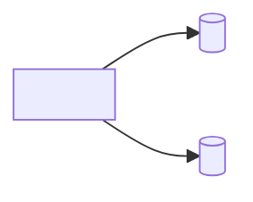

# Dữ liệu: tổng quan

> Template của design-architecture. Mục có `<!-- required -->` là bắt buộc. File này là bản đồ các kho dữ liệu; chi tiết nằm ở `databases/<db>/` và các file chung cùng thư mục. File này chỉ nhắc ID, không định nghĩa: `TBL-` định nghĩa ở `tables.md`, `BKT-` ở `object-storage.md`, `EVT-` ở `messaging.md`; không đặt ID ở ô đầu dòng bảng. Dự án không có object storage, cache hay kênh bất đồng bộ thì hồ sơ dự án ghi dòng cấp file `07-data/object-storage.md` (hoặc `cache.md`, `messaging.md`) là `bỏ` kèm lý do (Q8), và dòng tương ứng ở bảng dưới ghi "không có". Mỗi tham số thiết kế (số có đơn vị: thời gian chờ, giới hạn, ngưỡng, giờ bảo trì…) có ô "Cơ sở" hoặc "Cơ sở ước tính": ô đó chỉ tính là bằng chứng khi có ID (NFR, C, A, D, R, TC) hoặc link; chữ thuần ("kinh nghiệm team") thì `check_numbers.py` vẫn báo lỗi.

## Bản đồ kho dữ liệu
<!-- required -->

| Kho | Loại | Công nghệ | Service sở hữu | Chi tiết |
| --- | --- | --- | --- | --- |
| <tên, trùng thư mục `databases/<db>/` nếu là database> | <database, object storage, cache, kênh> | <[tên](../02-tech-stack/layers/data.md)> | <SVC-xx> | <[liên kết](databases/db/tables.md)> |

## Nguồn sự thật
<!-- required -->

Mỗi loại dữ liệu có đúng một nơi là nguồn sự thật; nơi khác chỉ là bản sao hoặc cache.

| Dữ liệu | Nguồn sự thật | Bản sao hoặc cache | Cách giữ đồng bộ |
| --- | --- | --- | --- |
| <loại dữ liệu> | <kho> | <kho, hoặc "không có"> | <link consistency.md> |

## Luồng dữ liệu giữa các kho
<!-- required -->

## Tối ưu
<!-- required -->

| Chỉ số | Mục tiêu (số + đơn vị) | NFR | Cách đo |
| --- | --- | --- | --- |
| <p95 truy vấn của luồng chính> | <số + đơn vị> | <NFR-xx> | <công cụ, vị trí đo> |

## Scale, nâng cấp, bảo trì
<!-- required -->

Tổng hợp bằng link, không chép lại (Q3): database ở `partitioning-retention.md` và `migration-strategy.md`, các kho còn lại ở file riêng và mục "Scale, nâng cấp, bảo trì" của `layers/data.md`.

| Kho | Nơi đã viết |
| --- | --- |
| <tên> | <[liên kết](databases/db/partitioning-retention.md)> |

## Rủi ro
<!-- required -->

Rủi ro dữ liệu (mất dữ liệu, tràn dung lượng, khóa nhà cung cấp) đã khai trong [sổ rủi ro](../11-risks/risk-register.md): <R-xx, …>.
