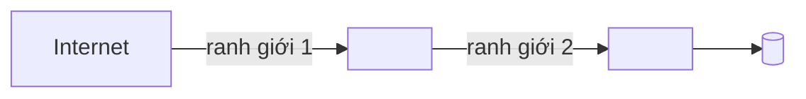

# Mô hình mối đe dọa

> Template của design-architecture. Mục có `<!-- required -->` là bắt buộc. Mỗi mối đe dọa phải có biện pháp và truy về một rủi ro `R-xx` trong [sổ rủi ro](../11-risks/risk-register.md) (Q6); điểm khả năng × tác động chấm ở sổ rủi ro, không chấm lại ở đây. File này chỉ nhắc ID, không đặt `TBL-`, `BKT-`, `R-`… ở ô đầu dòng bảng. Mỗi tham số thiết kế (số có đơn vị: thời gian chờ, giới hạn, ngưỡng, giờ bảo trì…) có ô "Cơ sở" hoặc "Cơ sở ước tính": ô đó chỉ tính là bằng chứng khi có ID (NFR, C, A, D, R, TC) hoặc link; chữ thuần ("kinh nghiệm team") thì `check_numbers.py` vẫn báo lỗi.

## Tài sản cần bảo vệ
<!-- required -->

| Tài sản | Vì sao quan trọng | Nơi lưu | Yêu cầu (FR hoặc C) |
| --- | --- | --- | --- |
| <tên> | <hậu quả khi lộ, mất, bị sửa> | <TBL-xx, BKT-xx, kho bí mật> | <FR-xx hoặc C-xx> |

## Ranh giới tin cậy
<!-- required -->

| Ranh giới | Hai phía | Cơ chế kiểm soát |
| --- | --- | --- |
| <tên> | <ngoài và trong> | <xác thực, mTLS, tường lửa> |

## Mối đe dọa
<!-- required -->

Phân loại theo STRIDE (giả mạo, chỉnh sửa, chối bỏ, lộ thông tin, từ chối dịch vụ, nâng quyền) hoặc khung tương đương.

| Mối đe dọa | Loại | Tài sản | Biện pháp | Rủi ro (R) | Biện pháp nằm ở |
| --- | --- | --- | --- | --- | --- |
| <mô tả cụ thể> | <loại> | <tài sản> | <việc làm để giảm> | <R-xx> | <cross-cutting.md, secrets-compliance.md, ci-cd.md…> |

## Rủi ro còn lại
<!-- required -->

Mối đe dọa chưa giảm hết và lý do giữ lại; mỗi dòng trỏ `R-xx` đã (hoặc cần) được người dùng chấp nhận nếu từ 15 điểm trở lên. Ghi "không có" nếu hết.

- <mối đe dọa: R-xx>

## Bảo trì
<!-- required -->

| Việc định kỳ | Tần suất | Giờ mỗi tháng | Cơ sở ước tính |
| --- | --- | --- | --- |
| <rà lại mô hình khi đổi kiến trúc hoặc thêm hệ thống ngoài> | <quý, mỗi lần đổi lớn> | <giờ> | <NFR-xx, C-xx, A-xx, D-xxx, R-xx, TC-xx hoặc link> |
