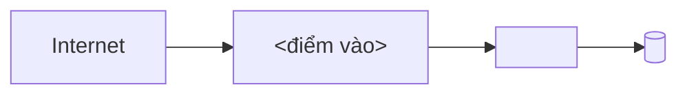

# Hạ tầng: topology

> Template của design-architecture. Mục có `<!-- required -->` là bắt buộc. Mức S bỏ cả phần 09-infrastructure. Cỡ máy và số instance theo mốc do `calc_capacity.py` tính ở [compute-sizing.md](../03-capacity/compute-sizing.md), chi phí ở [cost-model.md](../03-capacity/cost-model.md): **dẫn link, không chép lại**. Phiên bản và ngày hết hỗ trợ lấy từ [versions-features.md](../02-tech-stack/versions-features.md). File này chỉ nhắc ID, không đặt ID ở ô đầu dòng bảng. Mỗi tham số thiết kế (số có đơn vị: thời gian chờ, giới hạn, ngưỡng, giờ bảo trì…) có ô "Cơ sở" hoặc "Cơ sở ước tính": ô đó chỉ tính là bằng chứng khi có ID (NFR, C, A, D, R, TC) hoặc link; chữ thuần ("kinh nghiệm team") thì `check_numbers.py` vẫn báo lỗi.

## Thành phần hạ tầng
<!-- required -->

| Thành phần | Loại | Công nghệ hoặc nhà cung cấp | Vùng | Chứa container | Cỡ và số lượng |
| --- | --- | --- | --- | --- | --- |
| <tên> | <máy ảo, cụm container, database được quản lý, CDN, kho object> | <[tên](../02-tech-stack/layers/infrastructure.md)> | <vùng, khu> | <tên container ở containers.md> | <link compute-sizing.md> |

## Mạng
<!-- required -->

| Mục | Giá trị | Cơ sở |
| --- | --- | --- |
| Phân tách mạng | <mạng công khai, mạng riêng, mạng dữ liệu> | |
| Điểm vào từ Internet | <load balancer, gateway, CDN> | |
| Luồng ra Internet | <cho phép gì, qua đâu> | |
| Tên miền và chứng chỉ | <nơi quản lý, chu kỳ gia hạn (ngày)> | <NFR-xx, C-xx, A-xx, D-xxx, R-xx, TC-xx hoặc link> |
| Giới hạn băng thông ra (GB mỗi tháng) | <link storage-sizing.md hoặc cost-model.md> | |

## Sơ đồ
<!-- required -->

## Tối ưu
<!-- required -->

| Chỉ số | Mục tiêu (số + đơn vị) | NFR | Cách đo |
| --- | --- | --- | --- |
| <mức dùng CPU trung bình ở tải đỉnh> | <phần trăm> | <NFR-xx> | <công cụ, vị trí đo> |
| <chi phí hạ tầng so với ngân sách> | <phần trăm> | <NFR-xx hoặc C-xx> | <link cost-model.md> |

## Nâng cấp
<!-- required -->

| Thành phần | Phiên bản chốt | Ngày hết hỗ trợ gần nhất | Đường nâng cấp | Gián đoạn tối đa (giây) | Cơ sở |
| --- | --- | --- | --- | --- | --- |
| <hệ điều hành, nền tảng container, database được quản lý> | <link versions-features.md> | <YYYY-MM-DD, link> | <bản kế tiếp, việc phải làm> | <số> | <NFR-xx, C-xx, A-xx, D-xxx, R-xx, TC-xx hoặc link> |

## Bảo trì
<!-- required -->

| Việc định kỳ | Tần suất | Giờ mỗi tháng | Cơ sở ước tính |
| --- | --- | --- | --- |
| <vá hệ điều hành, gia hạn chứng chỉ, dọn tài nguyên thừa> | <tuần, tháng> | <giờ> | <NFR-xx, C-xx, A-xx, D-xxx, R-xx, TC-xx hoặc link> |

## Rủi ro
<!-- required -->

Rủi ro hạ tầng (khóa nhà cung cấp, một vùng duy nhất, vượt ngân sách) đã khai trong [sổ rủi ro](../11-risks/risk-register.md): <R-xx, …>.
