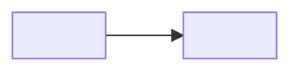

# Kế hoạch triển khai

> Template của design-architecture. Mục có `<!-- required -->` là bắt buộc. Đây là gói tài liệu giao cho từng agent dev; mức S chỉ giữ file này trong phần 12-roadmap. Mỗi gói là một phạm vi nhỏ đủ để một agent làm độc lập chỉ từ tài liệu trong gói. File này chỉ nhắc ID (`SVC-`, `FL-`, `TBL-`, `FR-`…) và link, không định nghĩa ID; gói công việc đặt tên tự do, không có ID riêng. Mỗi tham số thiết kế (số có đơn vị: thời gian chờ, giới hạn, ngưỡng, giờ bảo trì…) có ô "Cơ sở" hoặc "Cơ sở ước tính": ô đó chỉ tính là bằng chứng khi có ID (NFR, C, A, D, R, TC) hoặc link; chữ thuần ("kinh nghiệm team") thì `check_numbers.py` vẫn báo lỗi.

## Nguyên tắc cho agent dev

- Tài liệu trong gói là nguồn sự thật; không thêm thành phần, API, bảng hay phiên bản ngoài tài liệu.
- Chỗ tài liệu mâu thuẫn hoặc thiếu: dừng và hỏi (ghi câu hỏi), không tự quyết.
- Phiên bản công nghệ đúng như [versions-features.md](../02-tech-stack/versions-features.md); muốn đổi thì đi qua chế độ nâng cấp.
- Phần giao diện nhìn thấy do designer quyết; agent dev chỉ làm theo tài liệu của designer (`SCR-xx`).

### Áp dụng cho dự án
<!-- required -->
<!-- Chữ cố định ở trên luôn chép sang bản phát hành, không sửa. Mục này viết riêng cho dự án: (1) câu hỏi của agent dev ghi ở đâu và ai trả lời; (2) ai duyệt việc đổi phiên bản công nghệ; (3) tài liệu của designer nằm ở đâu và agent dev lấy `SCR-xx` từ đâu. -->

<cách áp dụng bốn nguyên tắc trên cho dự án này>

## Gói công việc
<!-- required -->

Mỗi service, mỗi app, mỗi database, và phần hạ tầng cần dựng có ít nhất một gói.

| Gói | Phạm vi | Tài liệu đầu vào | Yêu cầu (FR) và luồng (FL) | Phụ thuộc gói | Công sức ước tính (giờ) | Cơ sở ước tính |
| --- | --- | --- | --- | --- | --- | --- |
| <tên gói, đặt tự do, không có ID> | <SVC-xx, TBL-xx, tên app hoặc hạ tầng> | <liên kết tới thư mục hoặc file trong architecture/> | <FR-xx, FL-xx> | <tên gói khác hoặc "không"> | <giờ> | <NFR-xx, C-xx, A-xx, D-xxx, R-xx, TC-xx hoặc link> |

## Thứ tự và phụ thuộc
<!-- required -->

Lý do của thứ tự và những gói làm song song được: <giải thích>.

## Tiêu chí hoàn thành
<!-- required -->

| Gói | Tiêu chí đạt (kiểm được) | NFR | Cách kiểm |
| --- | --- | --- | --- |
| <tên gói> | <kết quả đo được, ví dụ p95 độ trễ API dưới ngưỡng> | <NFR-xx> | <kiểm thử, công cụ đo> |

## Truy vết yêu cầu sang gói
<!-- required -->

Mỗi FR của `requirements-trace.md` thuộc ít nhất một gói (Q1).

- <FR-xx: tên gói, …>
